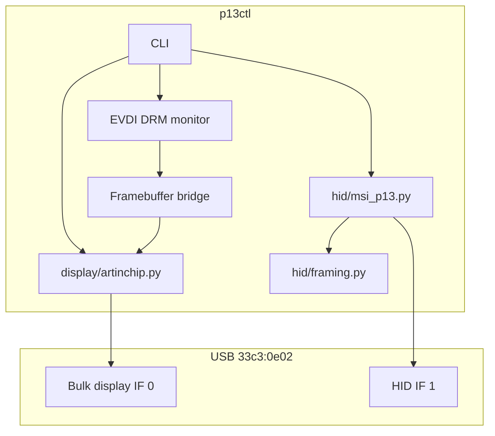

# Architecture

## Linux stack (this project)

On Linux, **p13ctl** uses EVDI to expose a standard 480×480 DRM monitor and bridges its framebuffer to the panel:

1. EVDI creates the desktop-visible virtual monitor.
2. The bridge reads its framebuffer and encodes it as JPEG.
3. The USB backend authenticates with the Artinchip firmware and streams frames.
4. HID commands control brightness, rotation, and host-display handoff.

Screen capture remains available as an explicit fallback with `p13ctl display desktop --capture`.

## Application lifecycle

`p13ctl-gui` owns the USB display interface; no systemd user services run.

- Login: an XDG autostart entry runs `p13ctl-gui --minimized`. The app starts in the tray and applies the saved Display Mode, retrying every 10 seconds until the panel enumerates. A failed login start never overwrites the saved mode with "off".
- Single instance: a `QLocalServer` guard. A second launch asks the first to show its window and exits.
- Close hides the window to the tray. Quit (tray menu) or SIGTERM stops the workers, waits for the USB interface, sends a black frame, and exits.
- Errors while the window is hidden appear as tray notifications.

## Out of scope

- **Pump/fan curves**: PWM headers on the motherboard.
- **ARGB**: 3-pin 5V ARGB header or JAF_2 on MSI boards.
- **Mystic Light sync**: motherboard ecosystem, not the P13 USB device.
